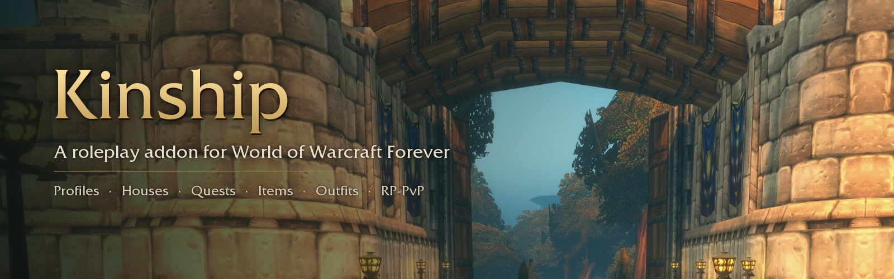
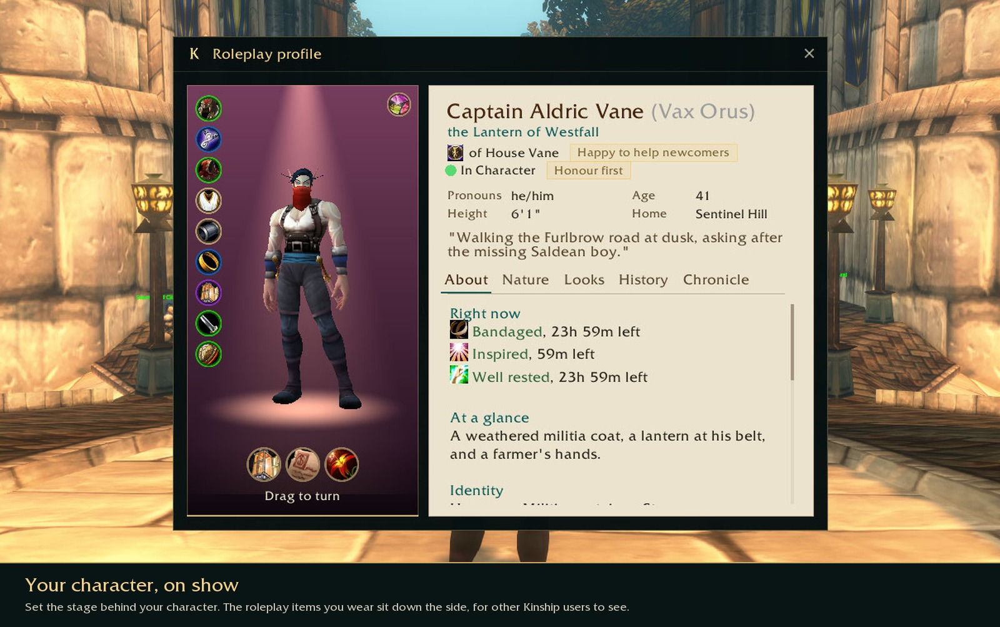
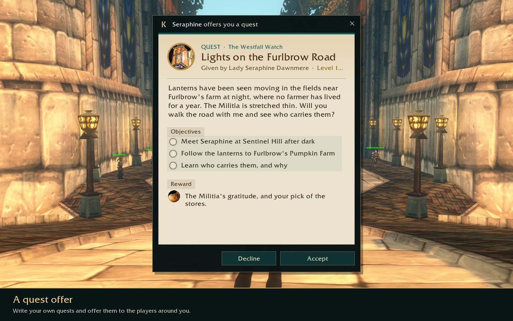
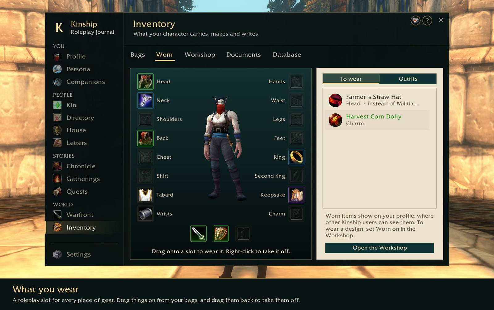

<p align="center">
  
</p>

<p align="center">
  <a href="https://ko-fi.com/vaxorus"></a>
  <a href="https://github.com/alexwaddell97/kinship-addon/releases/latest"></a>
</p>

# Kinship RP

A roleplay addon for World of Warcraft Forever. It keeps your character's profile, your family, the people you've met, what you carry and the stories you're part of in one journal, and tries to fit in with the game's own interface rather than sit on top of it.

It speaks the same profile protocol as Total RP 3, MyRolePlay and XRP, so players using those addons can read your profile and you can read theirs. It also runs happily alongside Total RP 3 if you'd rather keep it.

> Kinship is in beta. If something's broken or confusing, please [open an issue](https://github.com/alexwaddell97/kinship-addon/issues/new/choose).

## What it does

**Your character.** A profile with as much or as little as you like, glances (the details people notice first), personality traits, effects like being bandaged after a fight, and a stage you set out behind your character for when someone opens your profile.

<p align="center"></p>

**Quests you write.** Write a quest and offer it to the players around you. Objectives can tick themselves: reaching a place, doing an emote at someone, winning a duel, answering a riddle, finding a hidden stash, and plenty more. Run it as the storyteller and everyone who accepted sees the story move along.

<p align="center"></p>

**What you wear.** Design your own items, mark them as worn, and put them on: a roleplay slot for every piece of gear on the character screen. Save outfits and change into them with one click, or tie one to a profile. Other Kinship users see what you're wearing.

<p align="center"></p>

**Houses.** Characters who share a family name can form a house with a crest, motto and history.

**RP-PvP.** Forever has no RP-PvP realm, so Kinship adds a war stance, boundaries for injury, death, capture and crime, a record of rivals and battles, and Parley: a wheel of the game's own emotes that the other faction can see.

**And the rest.** Letters with wax seals, documents, trading items, stashes hidden in the world, gatherings on the calendar, dice, a satchel next to your bags, a Roleplay tab on the character sheet, and a directory of every roleplayer you've met.

## Using it with Total RP 3

You don't have to choose. When both are running, Kinship asks once:

- **Keep both.** Total RP 3 looks after your profile, tooltips, nameplates and target bar. Kinship hides its own versions and adds what Total RP 3 doesn't have. A Kinship button on Total RP 3's target bar shows what someone wears, their house and their stage. If you use Total RP 3: Extended too, you pick which addon looks after items, documents and effects.
- **Move to Kinship.** Your Total RP 3 profiles come across, Total RP 3 is switched off, and the game reloads. Its saved data isn't touched, so you can switch back any time.

Kinship never loads or depends on Total RP 3. It only notices when it's there.

## Installing

Download the latest version from CurseForge, or the zip from the latest [release](https://github.com/alexwaddell97/kinship-addon/releases/latest), and unzip it into:

```
World of Warcraft\_classic_beta_\Interface\AddOns\KinshipRP
```

The folder must be called `KinshipRP`. If you clone this repository instead, clone it into that folder name:

```
git clone https://github.com/alexwaddell97/kinship-addon.git KinshipRP
```

## Getting started

Type `/kin` to open the journal, or click the minimap button. The first time, Kinship asks how much roleplay you've done before, then offers a short tour of each page (Esc skips them, and the **?** at the top of the journal plays one again).

| Command | What it does |
|---|---|
| `/kin` | Open your journal |
| `/kin help` | List every command |
| `/kin view` | Your target's profile, or your own |
| `/kin outfit Name` | Change into a saved outfit |
| `/kin roll 2d6+3` | Roll dice |
| `/kin parley` | The Parley wheel |
| `/kin bug` | Details to copy into a bug report |

Key bindings are under Key Bindings > AddOns > Kinship RP.

## Reporting a bug

[Open a bug report](https://github.com/alexwaddell97/kinship-addon/issues/new?template=bug_report.yml). It asks for what `/kin bug` shows in game: copy everything in its box and paste it in. That includes Kinship's version and the last errors it caught, which makes things much quicker to track down.

Have an idea instead? [Suggest it here](https://github.com/alexwaddell97/kinship-addon/issues/new?template=idea.yml).

## A note on AI

Kinship is an AI assisted project.

## Licence

Kinship RP is © 2026 Vaxorus, all rights reserved. You're welcome to download it and use it for your own play; see [LICENSE](LICENSE) for the details. The libraries in [`Libs`](Libs) are included unmodified under their own licences, listed in [`Libs/README.txt`](Libs/README.txt).

World of Warcraft is a trademark of Blizzard Entertainment, Inc. Kinship RP isn't affiliated with or endorsed by Blizzard.

If you'd like to support development, I'm on [Ko-fi](https://ko-fi.com/vaxorus).
